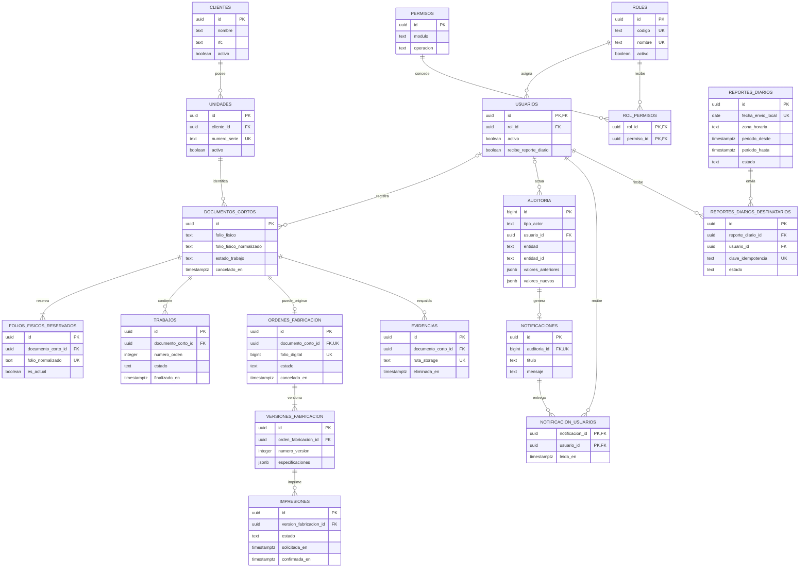

# Modelo ER V4 consolidado

**Estado:** propuesta corregida con las decisiones aprobadas del negocio. Migraciones no ejecutadas. Las tablas de facturación quedan fuera del esquema inicial y se conservan como propuesta futura separada.

## Entidades iniciales

- **Clientes y unidades:** un cliente puede tener varias unidades. `numero_serie` se almacena una sola vez en mayúsculas, solo con `A-Z` y `0-9`, y tiene UNIQUE global.
- **Documentos y folios:** cada hoja tiene un folio actual y múltiples folios reservados a lo largo de correcciones. La reserva histórica única conserva el valor anterior y evita su reutilización, incluso si el documento se cancela.
- **Trabajos:** conceptos ordenados por documento, con estado de producción `en_construccion` o `finalizado`.
- **Fabricación:** una orden opcional por hoja. El folio digital usa identity. Cada versión guarda un objeto JSONB completo y sus impresiones apuntan a esa versión.
- **Evidencias:** metadatos y ruta privada de Storage. La eliminación es lógica; el objeto binario no se purga automáticamente.
- **Usuarios y acceso:** cada usuario de aplicación corresponde a `auth.users`, pertenece a un rol. Los roles iniciales Administración, Ventas y Logística se cargan como catálogo aprobado; permisos posteriores se asignan por módulo y operación.
- **Auditoría y notificaciones:** todo cambio en las tablas operativas cubiertas requiere contexto de actor y genera auditoría y una notificación general para usuarios activos. La notificación no expone snapshots ni valores sensibles.
- **Reporte diario:** una ejecución lógica por fecha local de envío, 8:00 a. m. de `America/Monterrey`, con ventana del día calendario anterior y resultados por destinatario designado de Administración.

## Estados y finalización

Los únicos estados de producción son `en_construccion` y `finalizado` en hojas, trabajos y órdenes. Finalizar guarda usuario y hora. La hoja puede finalizarse independientemente del estado de sus trabajos y de la orden asociada. Bajo una hoja finalizada, un hijo pendiente puede completar únicamente la transición a `finalizado`; la base rechaza cualquier otro cambio en sus datos. Una dependencia para exigir hijos finalizados antes de cerrar la hoja podría añadirse después si el negocio la solicita y aprueba.

Las solicitudes de impresión (`solicitada`, `confirmada`, `fallida`, `cancelada`) y ejecuciones de correo (`pendiente`, `procesando`, `completado`, `fallido`) son estados técnicos, no etapas de producción.

## Facturación futura

`facturas_externas` no está en este diagrama ni en la secuencia inicial. Su borrador tentativo se guarda en `supabase/future_migrations/` y su relación hoja-factura no está aprobada como regla fiscal.
